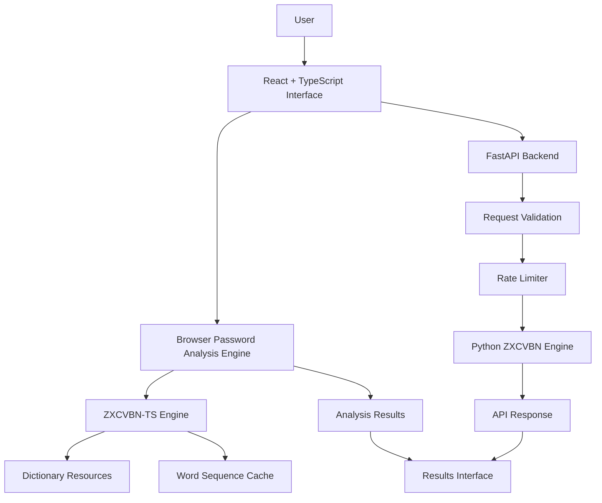

# -Password-Strength-Analyzer
SENTINEL – An advanced password security analyzer featuring intelligent strength evaluation, pattern detection, vulnerability assessment, and actionable security recommendations to help users build stronger, safer passwords.
# SENTINEL — Advanced Password Security Analyzer

<p align="center">
  **Intelligent Password Analysis | Pattern Recognition | Security Awareness**
</p>

<p align="center">
  An advanced password security analysis platform designed to help users understand password strength, identify predictable patterns, and make better password security decisions.
</p>

<p align="center">
  
  
  
  
  
</p>

---

## 1. Project Overview

**SENTINEL** is a password security analysis platform that evaluates password strength and provides actionable feedback to help users create stronger passwords.

Traditional password checkers often rely on simple rules such as minimum length, uppercase letters, numbers, and special characters. However, a password can satisfy all these requirements and still be highly predictable.

SENTINEL takes a more intelligent approach by using the ZXCVBN password estimation engine to analyze password patterns, dictionary matches, sequences, and estimated guessing difficulty.

The project combines a React and TypeScript frontend with a Python FastAPI backend, alongside dedicated password analysis, caching, testing, and performance profiling components.

### Project Goals

- Provide meaningful password strength evaluation.
- Identify common and predictable password patterns.
- Explain weaknesses through actionable feedback.
- Estimate password guessing difficulty.
- Improve analysis efficiency through custom word-sequence caching.
- Apply security controls to the backend API.
- Demonstrate practical cybersecurity engineering through testing and performance analysis.

## 2. Problem Statement

Passwords remain an important authentication mechanism, but many users create passwords using predictable patterns.

Examples include:

- Common dictionary words.
- Personal names and familiar terms.
- Sequential numbers and characters.
- Predictable substitutions.
- Repeated patterns.
- Common password combinations.

A password containing uppercase letters, numbers, and symbols is not necessarily resistant to guessing attacks.

Simple password validators cannot reliably identify these weaknesses.

### SENTINEL's Approach

SENTINEL uses pattern-aware password estimation to evaluate passwords beyond basic character requirements.

It provides a strength score, descriptive strength level, estimated guessing information, warnings, and recommendations.

## 3. Features and Technical Capabilities

### 3.1 Intelligent Password Strength Analysis

- Uses the ZXCVBN password estimation methodology.
- Evaluates password predictability rather than relying exclusively on character composition.
- Produces a score from 0 to 4.
- Displays five descriptive strength levels:
  - Very Weak
  - Weak
  - Fair
  - Strong
  - Very Strong

### 3.2 Dictionary-Based Pattern Recognition

The browser analysis engine loads multiple dictionary resources, including:

- Common passwords.
- Diceware vocabulary.
- Common English words.
- First names.
- Word sequences.
- Keyboard adjacency graphs.
- Language translations.

These resources help identify predictable password structures.

### 3.3 Actionable Security Feedback

Analysis results include:

- Password strength score.
- Descriptive strength level.
- Warning messages.
- Improvement suggestions.
- Estimated crack time.
- Estimated number of guesses.

### 3.4 Custom Word-Sequence Caching

SENTINEL includes a custom word-sequence caching component.

Its implementation is designed to optimize repeated word-sequence matching while preserving the original matcher behavior when the optional cache is unavailable.

Related engineering scripts support:

- Cache experiments.
- Cache invalidation testing.
- Cache safety checks.
- Candidate profiling.
- Matcher instrumentation.
- Result integrity checks.
- Performance comparisons.

### 3.5 Input Validation

The analysis implementations enforce a maximum password length of 256 characters.

The backend additionally validates that passwords are not empty.

### 3.6 Backend Security Controls

The FastAPI backend implements:

- Request rate limiting: 20 requests per minute per IP address.
- Restricted CORS origin for the local Vite development server.
- HTTP security response headers.
- Password input validation.
- No-store cache-control response header.

### 3.7 Automated Testing

The frontend includes dedicated test files for:

- Application behavior.
- Password analysis engine.
- Word-sequence cache.

Vitest and React Testing Library are used in the frontend testing setup.

## 4. System Architecture

SENTINEL consists of two main application components.

### Frontend

The frontend is built using React, TypeScript, and Vite.

It contains the browser-based password analysis engine, dictionary loading logic, custom caching implementation, and application interface.

### Backend

The backend uses Python and FastAPI.

It exposes HTTP endpoints for password analysis and applies request validation, rate limiting, CORS restrictions, and security headers.

### Architecture Diagram



### Architecture Components

| Component | Responsibility |
|---|---|
| React | User interface |
| TypeScript | Application logic and type safety |
| Vite | Frontend development and build tooling |
| ZXCVBN-TS | Browser password analysis |
| Word-sequence cache | Optimization of matching operations |
| FastAPI | Backend HTTP API |
| Python ZXCVBN | Backend password estimation |
| SlowAPI | API request rate limiting |
| Pydantic | Request validation |
| Vitest | Automated testing |

**Important:** The frontend and backend contain separate password analysis implementations. The diagram describes their components, not a guarantee that every frontend analysis request is sent to the backend.

## 5. Password Analysis Methodology

SENTINEL uses the ZXCVBN password estimation engine to evaluate password predictability.

Instead of treating every password as a random combination of characters, the engine analyzes recognizable structures and matching patterns.

### 5.1 Analysis Process

1. Receive the password.
2. Validate the permitted input length.
3. Load or reuse the initialized analysis engine.
4. Evaluate the password against available dictionaries and matching patterns.
5. Calculate a strength score and guessing estimate.
6. Generate warnings and improvement suggestions.
7. Return the analysis results.

### 5.2 Strength Classification

| Score | Classification |
|---:|---|
| 0 | Very Weak |
| 1 | Weak |
| 2 | Fair |
| 3 | Strong |
| 4 | Very Strong |

### 5.3 Guess Estimation

The analysis engine provides an estimated number of guesses and an estimated cracking time under a specified attack scenario.

These estimates are model-based and should not be interpreted as guaranteed real-world cracking times.

### 5.4 Dictionary Initialization

The browser engine asynchronously loads dictionary resources and initializes the ZXCVBN-TS factory.

A shared initialization promise allows concurrent analysis requests to reuse the same initialized engine.

If initialization fails, the implementation resets the promise so a subsequent request can retry initialization.

### 5.5 Custom Optimization

The word-sequence cache is installed after engine initialization.

If cache installation is unavailable, SENTINEL logs a warning and retains the original matcher methods.

This fallback behavior is important because an optimization should not silently compromise the correctness of password analysis.

## 6. Technology Stack

| Technology | Purpose |
|---|---|
| React 19 | Frontend interface |
| TypeScript 7 | Type-safe application development |
| Vite 8 | Frontend tooling and builds |
| Python | Backend development |
| FastAPI | REST API |
| Pydantic | Input validation |
| SlowAPI | Rate limiting |
| ZXCVBN-TS | Browser password analysis |
| Python zxcvbn | Backend password analysis |
| Vitest | Frontend testing |
| React Testing Library | Component testing |
| Oxlint | Frontend linting |

### Main Dependencies

**Frontend**

- `@zxcvbn-ts/core`
- `@zxcvbn-ts/language-common`
- `@zxcvbn-ts/language-en`
- `react`
- `react-dom`

**Backend**

- `fastapi`
- `uvicorn`
- `zxcvbn`
- `slowapi`

## 7. Installation and Setup

### Prerequisites

Install the following:

- Node.js and npm.
- Python 3.10 or a compatible supported Python version.
- Git.
- Visual Studio Code (recommended).

### Step 1: Clone the Repository

```bash
git clone https://github.com/vuchuru/-Password-Strength-Analyzer.git
```

Navigate into the project:

```bash
cd -Password-Strength-Analyzer
```

### Step 2: Install Frontend Dependencies

```bash
cd frontend
npm install
```

### Step 3: Start the Frontend

```bash
npm run dev
```

Open the local development URL shown in your terminal, normally:

```text
http://localhost:5173
```

### Step 4: Configure the Backend

Open another terminal from the project root.

```bash
cd backend
```

Create a Python virtual environment:

```bash
python -m venv .venv
```

Activate it on Windows PowerShell:

```powershell
.\.venv\Scripts\Activate.ps1
```

Install dependencies:

```bash
pip install -r requirements.txt
```

### Step 5: Start the Backend

```bash
uvicorn main:app --reload --port 8000
```

Backend address:

```text
http://127.0.0.1:8000
```

Interactive API documentation:

```text
http://127.0.0.1:8000/docs
```

The frontend's browser analysis engine can operate independently. Backend startup is needed when using the backend API.

## 8. API Documentation

SENTINEL exposes a FastAPI-based password analysis API.

### Base URL

```text
http://127.0.0.1:8000
```

### Endpoint 1: Health / Root

**GET /**

Checks whether the backend API is running.

Example:

```bash
curl http://127.0.0.1:8000/
```

Example response:

```json
{
  "message": "Password Strength Analyzer API",
  "status": "Running securely"
}
```

### Endpoint 2: Analyze Password

**POST /analyze**

Analyzes a supplied password using the Python ZXCVBN engine.

Request:

```http
POST /analyze
Content-Type: application/json
```

Example request body using a synthetic test value:

```json
{
  "password": "SyntheticExample123!"
}
```

Example response structure:

```json
{
  "score": 3,
  "strength": "Strong",
  "checks": {
    "Minimum 12 characters": true,
    "Uppercase letters": true,
    "Lowercase letters": true,
    "Numbers": true,
    "Special characters": true
  },
  "warning": "",
  "suggestions": [],
  "crack_time": "Example estimate"
}
```

The example values are illustrative, not a guaranteed output for that password.

### Response Fields

| Field | Description |
|---|---|
| `score` | Strength score from 0 to 4 |
| `strength` | Descriptive strength classification |
| `checks` | Basic character-composition checks |
| `warning` | ZXCVBN warning |
| `suggestions` | Improvement recommendations |
| `crack_time` | Estimated time under the configured attack scenario |

### Validation

The API accepts password values between 1 and 256 characters.

Requests exceeding the configured rate limit are rejected by SlowAPI.

For complete interactive API documentation, open `/docs` while the backend is running.

## 9. Testing and Performance Benchmarks

SENTINEL includes automated tests and dedicated performance-analysis scripts.

### 9.1 Automated Tests

Run the frontend test suite:

```bash
cd frontend
npm run test:run
```

Run tests interactively:

```bash
npm run test
```

### 9.2 Linting

```bash
npm run lint
```

### 9.3 Production Build

```bash
npm run build
```

This runs TypeScript project build checks followed by the Vite production build.

### 9.4 Performance Profiling

The repository contains dedicated scripts for performance investigation.

| Script | Purpose |
|---|---|
| `sentinel-benchmark.mjs` | Password analysis benchmarking |
| `sentinel-cache-experiment.mjs` | Cache experiments |
| `sentinel-cache-invalidation-test.mjs` | Cache invalidation checks |
| `sentinel-cache-safety-check.mjs` | Cache safety checks |
| `sentinel-candidate-profiler.mjs` | Candidate profiling |
| `sentinel-dictionary-duplicate-profiler.mjs` | Dictionary duplicate analysis |
| `sentinel-dictionary-probe-profiler.mjs` | Dictionary probe profiling |
| `sentinel-matcher-instrumentation.mjs` | Matcher instrumentation |
| `sentinel-preparation-profiler.mjs` | Preparation profiling |
| `sentinel-result-integrity-check.mjs` | Result integrity checks |

### 9.5 Benchmark Profiles

Historical benchmark outputs are stored in:

```text
frontend/benchmark-profiles/
```

These include baseline and experimental cache reports, CPU profiling, matcher instrumentation, and repeated benchmark runs.

Benchmark measurements depend on the hardware, runtime, test data, warm-up process, and execution environment.

Do not interpret synthetic benchmark results as universal password-cracking performance.

## 10. Security and Privacy Considerations

SENTINEL is an educational password security analysis project.

Security-related implementation includes:

- Browser-side password analysis.
- Maximum password length enforcement.
- Backend request validation.
- API rate limiting.
- Restricted development CORS configuration.
- HTTP security response headers.
- No-store response caching policy.

### Backend Security Headers

The backend currently applies:

| Header | Purpose |
|---|---|
| `X-Content-Type-Options: nosniff` | Helps prevent MIME-type sniffing |
| `X-Frame-Options: DENY` | Prevents framing by other sites |
| `Referrer-Policy: no-referrer` | Restricts referrer information |
| `Cache-Control: no-store` | Requests that responses are not stored in caches |

### Password Privacy

The browser analysis function evaluates passwords locally using the initialized ZXCVBN-TS engine.

The backend API also accepts passwords in request bodies for analysis.

Users should understand that passwords submitted to the backend are transmitted to that server. This project should not be represented as guaranteeing zero password transmission across every analysis path.

### Important Security Limitations

- Password strength estimates are not guarantees of account security.
- Estimated cracking times are scenario-dependent.
- HTTPS and production deployment security must be configured separately.
- The current CORS configuration is intended for local development.
- Rate limiting is not a substitute for a complete production abuse-prevention strategy.
- No independent production security audit is claimed.

**Never test SENTINEL using real account passwords.** Use synthetic test values.

## 11. Screenshots and Roadmap

### Screenshots

Application screenshots will be added here as the interface documentation is finalized.

Suggested repository structure:

```text
docs/
└── screenshots/
    ├── sentinel-dashboard.png
    ├── password-analysis.png
    ├── strength-results.png
    └── security-feedback.png
```

Once these images are added, they can be displayed in this section using GitHub Markdown.

### Development Roadmap

- [x] React and TypeScript frontend.
- [x] Browser-based password analysis.
- [x] ZXCVBN-TS dictionary integration.
- [x] Password strength classification.
- [x] Analysis warnings and suggestions.
- [x] FastAPI backend.
- [x] Backend input validation.
- [x] API rate limiting.
- [x] Security response headers.
- [x] Custom word-sequence caching implementation.
- [x] Automated frontend test infrastructure.
- [x] Benchmark and profiling scripts.

### Future Improvements

- [ ] Expanded API integration and error handling.
- [ ] Additional security-focused automated tests.
- [ ] International dictionary support.
- [ ] More comprehensive accessibility testing.
- [ ] Production deployment configuration.
- [ ] Continuous integration and automated quality checks.
- [ ] Expanded benchmark reporting with reproducible measurements.
- [ ] Additional password-pattern analysis research.

## 12. Project Structure

```text
Password-Strength-Analyzer/
│
├── backend/
│   ├── main.py
│   └── requirements.txt
│
├── frontend/
│   ├── benchmark-profiles/
│   ├── public/
│   ├── src/
│   │   ├── assets/
│   │   ├── security/
│   │   │   ├── passwordEngine.ts
│   │   │   ├── passwordEngine.test.ts
│   │   │   ├── wordSequenceCache.ts
│   │   │   └── wordSequenceCache.test.ts
│   │   ├── App.tsx
│   │   ├── App.css
│   │   ├── index.css
│   │   └── main.tsx
│   │
│   ├── sentinel-benchmark.mjs
│   ├── sentinel-cache-experiment.mjs
│   ├── sentinel-result-integrity-check.mjs
│   ├── package.json
│   └── vite.config.ts
│
├── .gitignore
├── package.json
├── package-lock.json
├── README.md
└── LICENSE
```

Additional profiling and testing scripts are included in the frontend directory.

## 13. Educational Disclaimer

SENTINEL is developed for educational, research, and cybersecurity awareness purposes.

It demonstrates password strength estimation, pattern analysis, optimization techniques, backend API development, and security-oriented software engineering.

It is not a password manager, authentication provider, or guarantee against password compromise.

Password strength estimation should be combined with unique passwords, a reputable password manager, and multi-factor authentication.

## 14. License

This project is distributed under the license included in the repository.

See [LICENSE](LICENSE) for the complete terms.

---

<p align="center">

**SENTINEL — Think Beyond Complexity. Understand Predictability.**

Built with a focus on cybersecurity, engineering, performance, and responsible security awareness.

</p>
